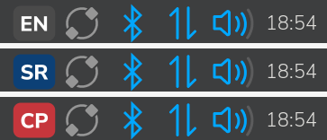
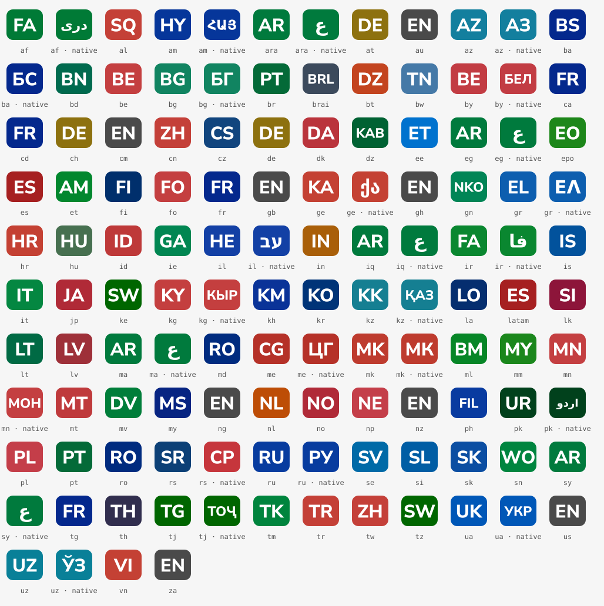

# labwc-layout-indicator

A small keyboard layout indicator for the system tray of [labwc](https://labwc.github.io/), the default
compositor of Raspberry Pi OS. It shows the active layout as a coloured badge and switches layouts with a click.



- **Fast and light.** Written in C. About 1 MB of its own memory (3.7 MB RSS including shared libraries), and the
  badge updates within milliseconds.
- **Click to switch.** Left click goes to the next layout, right click to the previous one, middle click back to
  the first.
- **A badge for every layout.** All 98 standard xkb layouts have a hand-picked label and a colour taken from their
  flag, toned down so white text stays readable. Layouts that type a non-Latin script are labelled in that script:
  СР, РУ, ΕΛ, עב, ქა.
- **No changes to the compositor.** Works with stock labwc and any StatusNotifierItem tray.

## Install

### Raspberry Pi OS, Debian and Ubuntu (arm64, armhf, amd64)

```sh
curl -fsSL https://raw.githubusercontent.com/b-baros/labwc-layout-indicator/main/install.sh | sh
```

The script downloads the right package from the [latest release](https://github.com/b-baros/labwc-layout-indicator/releases/latest),
installs it and starts the indicator. Run it again to update.

You can also download the `.deb` for your architecture from the releases page yourself and install it with
`sudo apt install ./labwc-layout-indicator_*.deb`. The indicator then starts at your next login.

### From source

For the Pi 1 and Pi Zero (ARMv6) and for other distributions:

```sh
sudo apt install build-essential meson ninja-build pkgconf libwayland-dev libxkbcommon-dev libsystemd-dev
git clone https://github.com/b-baros/labwc-layout-indicator.git
cd labwc-layout-indicator
meson setup build
meson compile -C build
sudo meson install -C build
```

This installs an autostart entry in `/etc/xdg/autostart` and a udev rule for `/dev/uinput` (see
[Security](#security)). If your session does not run XDG autostart entries, add `labwc-layout-indicator &` to
`~/.config/labwc/autostart`. Without systemd, sd-bus can come from libelogind or basu
(`meson setup build -Dsd-bus-provider=basu`).

## Usage

| Action       | Result                       |
|--------------|------------------------------|
| Left click   | next layout                  |
| Right click  | previous layout              |
| Middle click | first layout (the default)   |
| Hover        | full name of the layout      |

Your keyboard shortcut keeps working as before, and the badge follows it.

### More than two layouts on Raspberry Pi OS

The Raspberry Pi Control Centre offers only two layouts, but labwc accepts any number. Edit
`~/.config/labwc/environment`, for example:

```sh
XKB_DEFAULT_LAYOUT=us,rs,rs
XKB_DEFAULT_VARIANT=,latinyz,yz
XKB_DEFAULT_OPTIONS=grp:toggle
```

Then run `labwc --reconfigure`. Do the same in `/etc/xdg/labwc-greeter/environment` for the login screen. If you
change the keyboard in Control Centre later, it writes two layouts back.

## Badges



- **Label:** the language code (EN, DE, SR). Layouts that type a script covered by the fonts on a standard
  installation get a label in that script: Cyrillic, Greek, Hebrew, Arabic, Armenian, Georgian. Chinese, Japanese,
  Korean, Thai and Indic layouts keep Latin labels, which stay readable without extra fonts.
- **Colour:** from the language's flag, darkened where needed so white text has a contrast of at least 4.5:1
  ([tools/mute-color.py](tools/mute-color.py)). English is a neutral grey.
- **No look-alikes:** if two active layouts would get the same label, they are told apart by region (US/UK, DE/CH),
  then by variant (EN/DV for Dvorak), and as a last resort by number (SR1/SR2). A repeated colour is replaced by a
  second colour from the flag.
- **Unknown layouts** get a label from their code and a colour from a muted palette.

Would you like a different label or colour? Open an issue or a pull request. The table is in
[src/layouts.c](src/layouts.c).

## Requirements

- labwc. Tested with labwc 0.20 and wf-panel-pi 1.43 on Raspberry Pi OS (Debian trixie).
- A StatusNotifierItem tray. Tested with wf-panel-pi; others such as Waybar or sfwbar should work but are untested.
- For switching by click: write access to `/dev/uinput`, which the udev rule gives to the logged-in user.

The indicator relies on labwc sending keyboard events about the active layout to programs that do not have keyboard
focus. Other compositors may not do that. Sway, Hyprland and niri have layout modules in their own bars.

## How it works

- A plain Wayland connection receives the keymap (for the layout names) and `wl_keyboard.modifiers`, which carries
  the active layout. labwc sends both to clients without keyboard focus too.
- The badge is a StatusNotifierItem on D-Bus. Its SVG icons live in `~/.local/share/icons/hicolor`.
- labwc has no request for setting the layout, so a click taps the "next layout" key (`KEY_KBD_LAYOUT_NEXT`, or the
  configured layout shortcut) on a virtual uinput keyboard. The badge shows the target layout immediately, and
  layouts passed on the way are not shown.

## Security

The udev rule (`TAG+="uaccess"` on `/dev/uinput`) lets programs in the logged-in user's session create virtual
input devices, which can type keys. On a single-user desktop that adds little. If you want the indicator but not
switching by click, delete `/usr/lib/udev/rules.d/70-labwc-layout-indicator-uinput.rules`.

## Troubleshooting

- **No badge:** make sure the panel has a tray, then run `labwc-layout-indicator` in a terminal to see its messages.
- **Clicking does nothing** and the terminal shows `/dev/uinput: Permission denied`: log out and back in once after
  installing.

## Alternatives

[wlroots-kbdd](https://github.com/avarvit/wlroots-kbdd) together with
[wf-panel-pi-kbdlayout](https://github.com/avarvit/wf-panel-pi-kbdlayout) adds layout reporting to labwc itself,
through `LD_PRELOAD` and a wf-panel-pi plugin. It can remember the layout per window. It requires editing
`/usr/bin/labwc-pi` and rebuilding whenever wlroots changes. This project needs no changes to the compositor.

## Roadmap

See [ROADMAP.md](ROADMAP.md).

## License

[MIT](LICENSE)
